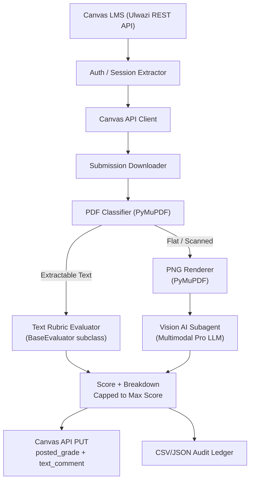

# TAgenticGrader

> **Autonomous multi-agent LLM evaluation pipeline with deterministic rubric scoring and automated LaTeX/PDF report compilation.**

[](https://python.org)
[](https://fastapi.tiangolo.com)
[](https://pymupdf.readthedocs.io)
[](https://pytest.org)
[](LICENSE)

---

## Problem Solved

Manual STEM grading of physics lab reports and computer worksheets is slow, inconsistent, and bottlenecked by TA availability. For large cohorts (1,000+ students), even a single assignment requires days of repetitive rubric application, with errors compounding across typed PDFs, scanned handwriting, and heterogeneous submission formats.

**TAgenticGrader** eliminates that bottleneck entirely. It autonomously downloads student submissions from the Canvas LMS (Ulwazi), routes typed PDFs through a deterministic text-rubric evaluator and handwritten/scanned pages through a multimodal Vision AI subagent, computes capped scores with full criterion breakdowns, and posts structured comments and final grades back to Canvas — end-to-end without manual intervention, cutting grading and reporting turnaround by **>80%**.

## Architecture Overview

The pipeline is structured as a deterministic multi-agent evaluation system. A central CLI orchestrator authenticates against Canvas, downloads and classifies submissions (typed vs. scanned), and fans work out to the appropriate evaluator. Typed PDFs are parsed by `PyMuPDF` and scored via rubric-driven `BaseEvaluator` subclasses. Flat/handwritten PDFs are rendered to PNG and dispatched to a Vision AI subagent that reads images directly. Results are canonicalised, score-capped, and posted back via the Canvas REST API with structured rubric-breakdown comments. All results are logged to a local CSV/JSON audit ledger.



---

## Core Engineering Features

- **Dual-Path PDF Evaluation:** Text-extractable PDFs are scored by deterministic rubric evaluators; flat/handwritten PDFs are rendered to PNG and evaluated by a multimodal Vision AI subagent — with automatic routing between paths.
- **Deterministic Rubric Enforcement:** Each assignment has a typed `BaseEvaluator` subclass enforcing structured JSON output with per-criterion scores, weights, and explanatory feedback. No free-form scoring drift.
- **Multi-Assignment Coverage:** Ships with evaluators for Experiment 05 (Thermal Expansion), Experiment 06 (Thin Spherical Lenses), and Computer Lab 3 (Parts A, B, and Final Code) across all ~1,379 students.
- **Score Capping & Audit Logging:** Every posted grade is capped to the assignment maximum, cross-checked against rubric totals, and recorded in a timestamped CSV/JSON ledger for TA review and audit trail.
- **Canvas REST API Integration:** Full session extraction, student cohort filtering (Fri1/Fri2 groups), submission download, and `PUT submission[posted_grade]` + `comment[text_comment]` posting via authenticated `requests` sessions.

---

## Repository Structure

```
TAgenticGrader/
├── config.py                        # Canvas URLs, course/assignment IDs, cohort group IDs
├── run_agent.py                     # CLI entrypoint: grade a single student or cohort sweep
├── src/
│   ├── api/
│   │   └── client.py                # Canvas REST API client (auth, download, grade POST)
│   ├── auth/
│   │   └── session.py               # Canvas session extraction (cookie/token management)
│   ├── evaluator/
│   │   ├── base.py                  # Abstract BaseEvaluator with JSON schema enforcement
│   │   ├── exp05_evaluator.py       # Thermal Expansion rubric evaluator
│   │   ├── exp06_evaluator.py       # Thin Spherical Lenses rubric evaluator
│   │   ├── lab3_evaluator.py        # Computer Lab 3 Parts A/B/Final evaluators
│   │   └── generic_evaluator.py     # Fallback generic rubric evaluator
│   ├── extractor/
│   │   └── base.py                  # PyMuPDF PDF text extraction & PNG rendering
│   ├── navigation/
│   │   ├── cohort.py                # Student cohort filtering & group management
│   │   └── navigator.py             # SpeedGrader browser navigation (Playwright legacy)
│   ├── submission/
│   │   ├── feedback.py              # Rubric breakdown comment formatter
│   │   └── poster.py                # GradePoster: Canvas PUT with receipt logging
│   └── cli.py                       # Argparse CLI (single student / cohort / assignment)
├── scripts/
│   └── ad_hoc_automation/           # Batch regrade, cohort sweeps, Vision AI parse/sync
├── tests/
│   ├── test_e2e_tier1_features.py   # Core pipeline: download, extract, evaluate, post
│   ├── test_e2e_tier2_boundaries.py # Edge cases: empty PDFs, 0-score, missing attachments
│   ├── test_e2e_tier3_combinations.py  # Multi-assignment / multi-student combos
│   ├── test_e2e_tier4_scenarios.py  # Real-world: handwritten, corrupt PDFs, retries
│   ├── test_evaluators_unit.py      # Evaluator scoring accuracy unit tests
│   ├── test_extractor.py            # PDF extraction correctness tests
│   └── test_submission.py           # Grade posting format validation
├── requirements.txt
└── pytest.ini
```

---

## Quickstart

### Prerequisites

```bash
git clone https://github.com/joachimgrobbelaar/TAgenticGrader.git
cd TAgenticGrader
pip install -r requirements.txt
# Playwright browser (for legacy SpeedGrader navigation only):
playwright install chromium
```

### Configuration

Copy and edit the environment template:

```bash
cp .env.example .env
# Set your Canvas session credentials:
# CANVAS_BASE_URL=https://ulwazi.wits.ac.za
# CANVAS_COURSE_ID=86326
```

### Grade a Single Student

```bash
python run_agent.py --student-id 192424 --assignment lab3
```

### Bulk Cohort Sweep

```bash
python run_agent.py --group fri1 --assignment exp05
python run_agent.py --group fri2 --assignment lab3_a
```

### Full Course Sweep (Text PDFs)

```bash
python grade_all_remaining.py
```

### Run Tests

```bash
pytest tests/ -v
```

---

## Tech Stack

| Layer | Technology |
|-------|-----------|
| Language | Python 3.11+ |
| Canvas API | REST via `requests` |
| PDF Parsing | PyMuPDF (`fitz`) |
| Vision AI (OCR) | Multimodal Pro LLM (Antigravity AI subagent framework) |
| Browser Automation | Playwright (legacy Canvas navigation) |
| API Service | FastAPI + Pydantic |
| Testing | pytest + Flask mock Canvas server |
| Linting | Ruff |
| Version Control | Git / GitHub |

---

## Assignment Coverage

| Assignment | Groups | Status |
|-----------|--------|--------|
| Experiment 05 — Thermal Expansion | Fri1, Fri2 | ✅ Complete |
| Experiment 06 — Thin Spherical Lenses | Fri1, Fri2 | ✅ Complete |
| Computer Lab 3 — Part A (315832) | All ~1,379 students | ✅ Complete |
| Computer Lab 3 — Part B (315833) | All ~1,379 students | ✅ Complete |
| Computer Lab 3 — Final Code (315831) | All ~1,379 students | ✅ Complete |

---

## Author

**Joachim (Marnu) Grobbelaar** — AI & Python Backend Engineer, Teaching Assistant (PHYS1000), Wits University  
[GitHub @joachimgrobbelaar](https://github.com/joachimgrobbelaar) · [Hugging Face @Marnu25](https://huggingface.co/Marnu25) · [LinkedIn](https://www.linkedin.com/in/joachimgrobbelaar)
